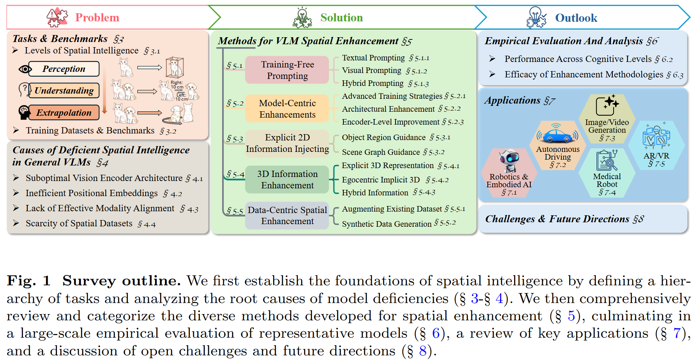
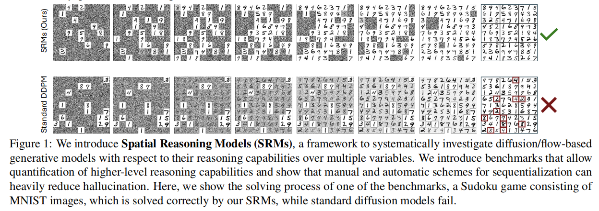
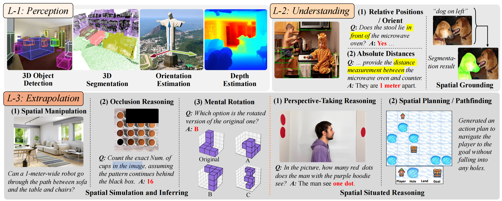
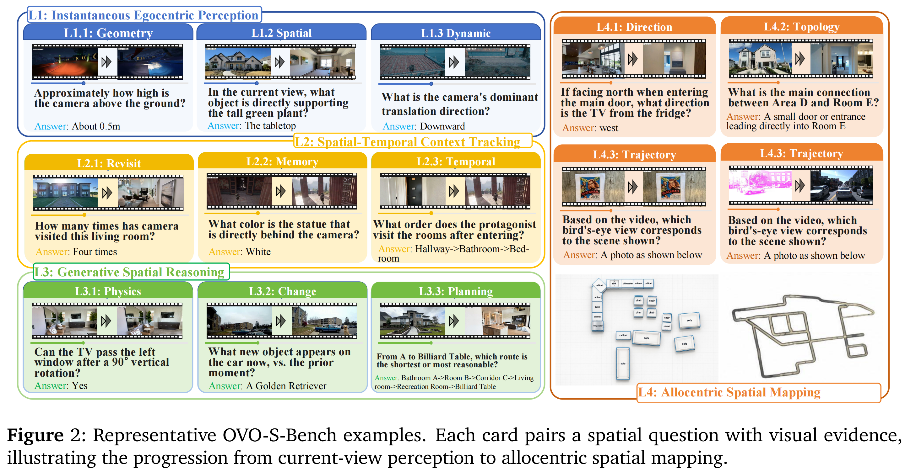
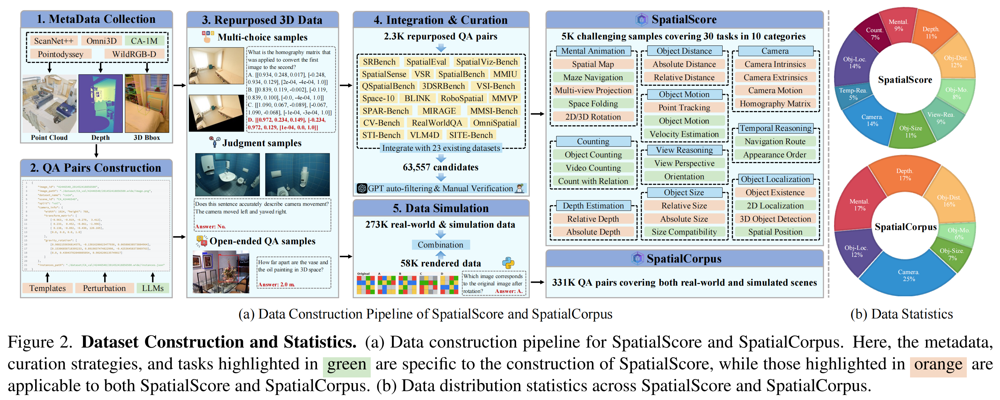
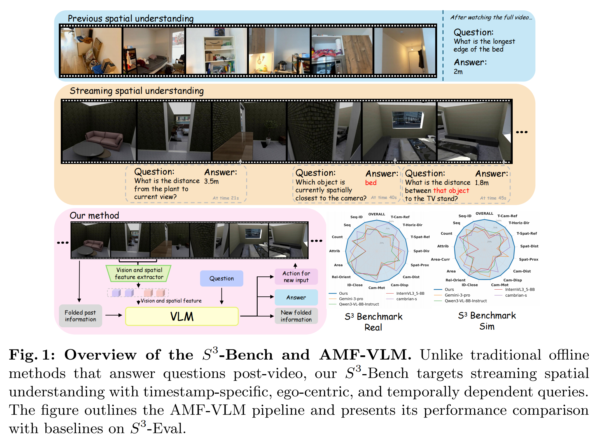
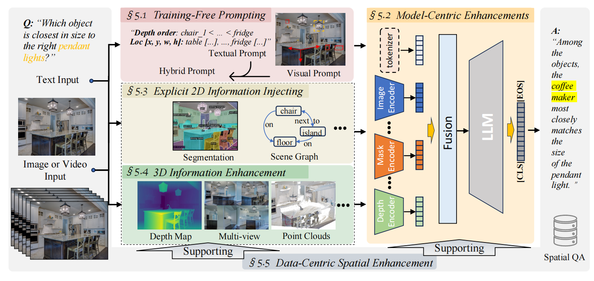
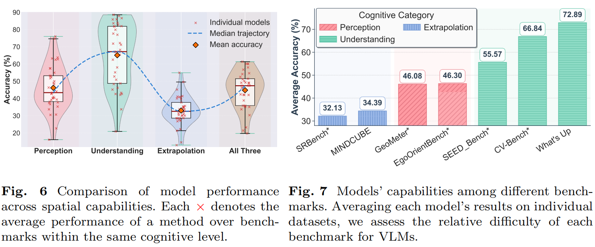
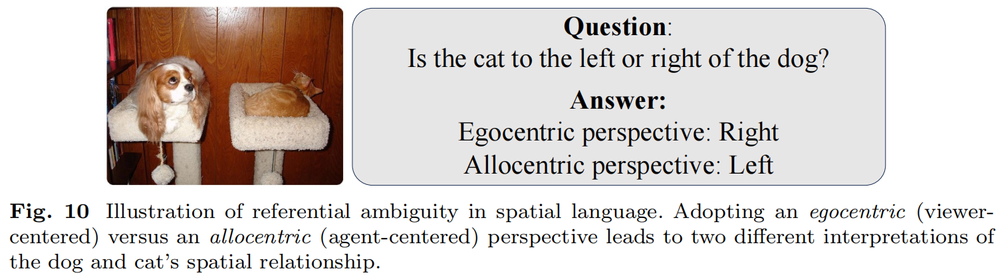
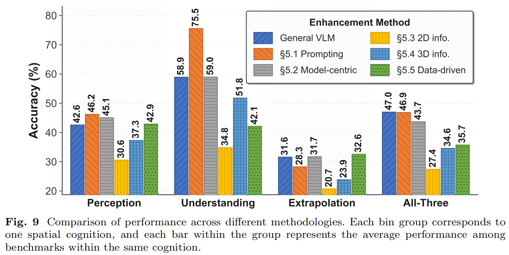

## 论文信息

[Spatial intelligence in vision-language models: a comprehensive survey](https://www.techrxiv.org/doi/full/10.36227/techrxiv.176231405.57942913/v2)

- **作者：**Disheng Liu、Tuo Liang、Zhe Hu、Jierui Peng、Yiren Lu、Yi Xu、Yun Fu、Yu Yin；通讯作者 Yu Yin。
- **机构：**Case Western Reserve University、Northeastern University。
- **期刊：**Artificial Intelligence Review，2026；官网显示 2026-08-11 发表，DOI：10.1007/s10462-026-11671-x。
- **项目页面：**[Spatial intelligence in vision-language models](https://dishengll.github.io/Awesome-Spatial-VLMs/)

## 1. 文章结构

| 部分 | 回答的问题 |
| --- | --- |
| §2 背景 | 空间智能为何超出语义识别，纯语言推理为何不够 |
| §3 任务、数据、基准 | 应该测什么，已有数据覆盖什么 |
| §4 失败原因 | VLM 在哪些环节丢失空间信息 |
| §5 增强方法 | 如何在输入、模型、几何信息和数据上干预 |
| §6 实证评估 | 哪些能力仍弱，增强方法能否跨任务泛化 |
| §7 应用 | 空间能力如何用于具身、驾驶、生成、医学和 AR/VR |
| §8–9 展望与结论 | 几何先验、语义细节权衡、指代与视角歧义 |
| 附录 A/B | 数据资源清单、基准子集和推理设置 |

由于论文收集的时间比较久（2023 年 1 月至 2025 年 10 月）且内容较多（24 个训练数据集、50 个评估基准以及 90 余项增强工作），下面主要介绍关注重点。

该论文对应的同名项目[**Spatial intelligence in vision-language models**](https://dishengll.github.io/Awesome-Spatial-VLMs/)，仍在更新最新的论文。

## 2. Spatial Reasoning的定义

在该论文中，“人类空间认知”（**Human Spatial Cognition**） 被分为 **4 种能力**：

1. **空间感知（Spatial Perception）**：感知并视觉理解环境内部及环境之外的空间信息的能力，涵盖特征、属性、测量、形状、位置和运动。

2. **心理旋转与变换（Mental Rotation and Transformation）**：在二维或三维空间中对物体进行心理操作的能力。

3. **空间记忆（Spatial Memory）**：对空间配置和布局信息进行编码、存储和检索，从而形成认知地图的基础。

4. **空间推理（Spatial Reasoning）**：在物理世界中理解、操作和导航物体及其空间关系的心理能力。

| 能力 | 主要作用 | 例子 |
| --- | --- | --- |
| **空间感知** | 从视觉中获取形状、位置、朝向、距离和运动等信息 | 看出桌子和墙之间有一道窄缝 |
| **心理旋转与变换** | 在脑中对空间表征进行变换 | 想象把桌子转过 90° 后的样子 |
| **空间记忆** | 保存、更新和提取空间布局 | 记得门在走廊尽头，转角处有柜子 |
| **空间推理** | 综合空间关系与约束，进行判断、预测或规划 | 判断桌子能否穿过门，以及应该怎样搬 |

## 3. Spatial Reasoning的任务

实际上，当前关于spatial reasoning的研究如果按照上述标准分类，实际测的可能分别是深度感知、左右关系、心理旋转或路径规划。

**（个人补充）**甚至在论文 [Spatial Reasoning with Denoising Models](https://arxiv.org/pdf/2502.21075) 中，对于 spatial reasoning 不局限于物理世界的三维几何，而包括**图像等空间组织的数据域。**例如补全 MNIST 数独，使行、列、宫的约束成立，如下图所示。进一步的，前端设计、PPT排版也可以算一种 Spatial Reasoning。
{: .notice}

所以共用一个名称，会掩盖任务要求的差异。论文受人类空间认知启发，引入了**感知**、**理解**和**外推**的三层认知层级。

| 层级 | 核心问题 | 典型任务 |
| --- | --- | --- |
| L1 感知 Perception | 单个对象的几何属性是什么 | 3D 检测、3D 分割、朝向估计、深度估计 |
| L2 理解 Understanding | 对象之间如何排列 | 空间关系 VQA、空间指代表达定位 |
| L3 外推 Extrapolation | 如何推断当前未直接观察到的状态 | 空间模拟与推理（Inferring）：（1）物体操作（2）遮挡推断（3）心理旋转 空间具身推理（Reasoning）：（1）空间视角转换（2）路径规划 |

## 4. Spatial Reasoning的数据与Benchmark

论文在其项目网站 [Spatial Reasoning with Denoising Models](https://arxiv.org/pdf/2502.21075)按照以下规则收集了部分数据，时间跨度在2023年到2025年。

- 三个任务层级：感知、理解、外推
- 六种典型任务：3D 检测、朝向估计、深度估计、空间关系 VQA、空间模拟与推理、空间具身推理
- 三种模态:点云、RGB、深度图

由于论文收集的时间比较久（2023 年 1 月至 2025 年 10 月）且内容较多，具体数据不做过多赘述。

### 现状

数据量正在增加，但数据与基准盘点主要聚焦空间 VQA，因此不能视作对全部空间任务、机器人操作或三维重建资源的穷尽覆盖，目前仍存在以下问题

- 认知失衡：主要以L1、L2为主
- 规模不足：数据量相较于文本数据仍然太少
- 模态偏置：多为2D数据

### 补充阅读

这篇报告调研到2025年的数据，缺少对于流式视频空间理解的数据调研，补充几篇目前在读的数据集

#### OVO-S-Bench（EMNLP 2026 Oral）

[OVO-S-Bench: A Hierarchical Benchmark for Streaming Spatial Intelligence in Multimodal LLMs](https://internlm.github.io/OVO-S-Bench/)

**摘要：**

现有的基准测试要么针对完整视频进行离线评估，要么以事件而非空间结构为目标。我们推出了 OVO-S-Bench，这是一个针对流式空间智能的完全由人类标注的基准测试集，包含 348 段源视频的 1,680 个问题。标注工作由 12 名经过培训的标注员完成（每位标注员同时担任盲审交叉评审员），累计投入约 804 人时，并经过多轮质量保证。每个问题均附带一个查询时间戳和一个证据区间；在评估时，模型仅能看到查询之前的前缀内容。问题涵盖四个抽象程度递增的层级：瞬时自我中心感知、时空上下文跟踪、生成式空间推理以及去中心空间映射。

#### SpatialScore（CVPR 2026 Highlight）

[SpatialScore: Towards Comprehensive Evaluation for Spatial Intelligence](https://haoningwu3639.github.io/SpatialScore/)

**简介：**

现有的多模态大语言模型（MLLMs）空间智能评估通常较为碎片化且范围有限。在本工作中，我们对现代MLLMs的空间理解能力进行了整体性评估，并提出了互补的数据驱动和基于智能体的解决方案。

具体而言，我们做出了以下贡献：

(i) 我们提出了SpatialScore，这是迄今为止最全面、最多样的多模态空间智能基准，涵盖多种视觉数据类型、输入模态和问答格式，包含跨30个不同任务的约5K个人工验证样本；

(ii) 我们构建了SpatialCorpus，这是一个大规模训练资源，包含331K个多模态问答样本，用于对Qwen3-VL进行空间理解方面的监督微调；

(iii) 我们开发了SpaitalAgent，这是一个多智能体系统，集成了12个专门的空间感知工具，支持Plan-Execute和ReAct两种推理范式，能够以无需训练的方式改进空间推理；

以及(iv) 我们对40个具有代表性的MLLMs进行了广泛评估，揭示了空间智能方面持续存在的挑战，同时展示了我们的数据驱动和基于智能体的解决方案的有效性。

#### S^3-Bench

[See, Remember, Explore: A Benchmark and Baselines for Streaming Spatial Reasoning](https://arxiv.org/pdf/2603.23864)

**简介：**

空间理解是具身智能体的基础能力，然而大多数空间视觉语言模型（VLM）和基准仍处于离线状态——它们评估的是对预先录制输入的事后问答，并忽视了两个对部署至关重要的需求：长时程流式推理，以及当前视野不足时的主动感知。为填补这一空白，我们提出了S3-Bench，一个用于流式空间问答并支持主动探索的基准套件，其中查询在时间上锚定到特定时间戳，且必须仅使用截至该时刻可获得的观测来回答。

S3-Bench采用双域设计，结合了具有可控轨迹和探索动作的可扩展模拟器，以及捕获实际传感伪影的真实世界流式视频，用于严格的泛化评估。总体而言，它涵盖10K+个场景和26K+条轨迹，并设有专门的训练（S3-Train）和评估（S3-Eval）划分。

我们进一步提出了AMF-VLM，它通过以下方式在有限计算下支持流式空间推理：(i) 记忆折叠，将长时程观测压缩为紧凑的结构化记忆；(ii) 主动探索，输出显式动作（例如移动/旋转/扫描）以在回答前获取缺失的证据。大量实验表明，与使用相同训练数据的模型相比，我们的方法在S3-Eval的模拟划分和真实划分上分别取得8.8%和13.3%的提升，同时保持了对标准空间基准具有竞争力的可迁移性。

## 5. 通用VLM模型在Spatial Reasoning任务中的局限

作者分析了目前通用VLM模型直接用在Spatial Reasoning任务中存在那些局限：

1. **视觉编码器偏向全局语义。** CLIP 类特征擅长识别“有哪些东西”，但可能弱化形状、位置、朝向及细粒度布局。（这里和我之前利用卷积token剪枝得到的结论有点相似，最近开始引入扩散模型进行理解对象关系、帧间关系的工作）

2. **位置编码没有被有效利用。** 许多位置嵌入设计在架构上并非最优；视觉 token 的幅值还可能压过较弱的位置线索。加入位置编码不等于模型一定使用它。

3. **跨模态对齐过于粗糙。** 图像与文本整体匹配，未必要求正确绑定“哪个对象—什么属性—与谁存在什么关系”；容易呈现 bag-of-concepts 式行为。（推荐阅读CoV）

4. **空间监督不够。** 数据缺少精确距离、丰富关系类别和外推任务，多视角与原生 3D 数据也较少。

**注**：这一节与前文的衔接过渡较差，以及对于“VLM在面对需要精确空间理解的任务时表现出系统性局限”判据没有明确指出，虽然后面在实验数据中能展现，但颇有“射箭打靶”的意味。
{: .notice}

## 6. 增强方法总结

| 类别 | 原理 | 方式 | 工作 | 局限 |
| --- | --- | --- | --- | --- |
| §5.1无训练提示 | - 文本提示 - 视觉提示 - 混合提示 | 提示词工程、文字步骤拆分 带坐标网格的格式化输入、引入掩码 工具或模型外部调用、可视化思维链 | SpatialPrompt、CCoT、SoM、Scaffold、ZeroVLM、MindJourney | 依赖底座已有能力，额外线索可能干扰外推 |
| §5.2 模型增强 | - 训练策略优化 - 架构增强 - 编码器改进   （个人感觉） | 辅助任务（图像重建、坐标推理）、强化学习、蒸馏 模态连接器、注意力机制 引入DINO、引入多编码器 | ROSS、ViLaSR、MVoT、Cambrian-1、SpatialCLIP | 需要训练并可能影响通用能力 |
| §5.3显式 2D 信息注入  | - 对象-区域先验 - 空间关系先验   （需要同“无训练提示-视觉提示”项进行区别） | 利用RoI增强空间理解能力 引入场景图（Scene Graph）提升视觉空间表示能力  | RegionGPT、GPT4ROI、VCoder、SGVL、LLaVA-SG | 二维投影无法消除全部三维歧义 |
| §5.4 3D 信息增强 | - 显式 3D 几何表示 - 隐式 3D 空间信息感知 - 融合算法  | 引入点云、体素、深度图进行训练 从第一人称视频的运动过程中的物体变换感知3D空间信息、从多个视角之间的物体空间关系感知3D空间信息 2D图像先3D建模后推理，或多模态联合建模后推理 | 3D-LLM、SpatialRGPT、SpatialBot、VLM-3R、LLaVA-3D、SplatTalk | 依赖几何质量、模态适配与融合方式 |
| §5.5 数据增强 | - 真实数据增强 - 模拟数据生成 | 一般和其他工作联合，不做具体阐述 | SpatialVLM、RoboSpatial、SPAR-7M、Sparkle、Open3DVQA | 需防模板捷径、伪标签错误和分布偏差 |

## 7. 实验

论文开展了一项大规模的模型评估实验，由于实验评估的模型重点关注到2025年10月公开可访问的2D VQA模型，故仅能说明部分趋势，对模型实际表现不做具体讨论。

### 7.1 实验设置

| 评估类别 | 本文使用的基准 | 主要测量内容 |
| --- | --- | --- |
| 感知 | EgoOrientBench\*、GeoMeter\* | 朝向、尺寸/深度相关感知 |
| 理解 | CV-Bench\*、What's Up、SEED-Bench\* | 相对位置、距离、关系和实例定位 |
| 外推 | SRBench\*、MINDCUBE | 心理旋转、折纸、导航、多视角空间心智建模 |
| 综合 | RealWorldQA、OmniSpatial | 多层空间能力的混合任务 |

**注：**星号表示作者选取的子集，不能把结果当成完整原基准成绩。原始 VQA 是主要输入形式，主要指标为答案准确率。
{: .notice}

### 7.2 模型设置

| 类别 | 模型 |
| --- | --- |
| 商业模型 | GPT-4o、GPT-5、Gemini 2.5 flash、Gemini 2.5 pro |
| 开源通用VLM | LLaVA、Qwen2.5 |
| 空间特化VLM | - 基于提示方法：patialPrompt、CCOT、SoM、Scaffold - 模型优化和2D增强的方法：ROSS、ViLaSR、M2-Reasoning、LLaVA-AURORA 、AdaptVis、Honeybee、Cambrian-8B、VPT、VCoder（2D） - 3D增强的方法：LLaVA-3D、Spatial-Bot、VCoder w. Depth - 数据增强：SpatialVLM、OmniSpatial |

所有选定的模型均在所有基准上以最小的设置调整进行推理。为确保稳定且可复现的生成，我们采用确定性解码设置（在适用的情况下，温度= 0和do sample=False）。

### 7.3 结论

#### 7.3.1 认知水平间的能力失衡

性能层次：理解&gt; 感知 &gt; 外推

表明模型最**难处理超出可观察内容的推断**，同时尽管它们在关系推理方面具有优势，却意外地表现出较弱的基础空间意识。

作者也指出了现有**benchmark的设计存在问题**：强调以视觉为中心的空间理解，并聚焦于相对位置。忽视了以对象为中心的案例以及对象之间的其他空间关系，例如相对方向和绝对距离。

采用自我中心（以观看者为中心）与异中心（以主体为中心）视角会导致对狗和猫空间关系的两种不同解读。这种设计偏差可能抬高了模型表面的性能，掩盖了模型在真实的空间感知的局限性。

#### 7.3.2 增强方法的有效性

**结论：**

- **不存在对各任务通用增强策略**
- **基于提示方法**：通过显式的注意力引导提升了感知与理解能力，但在过度指定的线索变成干扰而非助益的情况下，会降低外推性能。
- **基于2D、3D的方法**：专用空间模型的跨任务泛化不足

**个人解读：**

- 几个结论都是说目前的增强方法泛化性差，不同增强策略有不同应用场景。
- L2 任务效果高于 L1 任务不等于模型可以跳过感知进行可靠推理。一方面这个任务分类是基于作者对“人类空间认知”的理解进行层级化分类，其合理性仍需要讨论；另一方面数据集或者任务可能有捷径。
- 测试模型局限在2D VQA模型，增强方法在机器人操作等真实任务中的价值仍需相应任务来检验。
- 对于模型优化和数据增强，论文缺少能分离各项因素贡献的对照。
- 论文也没有解释 Fig. 9 All-Three部分General VLM是最好的原因，个人理解通用模型是否因为训练数据覆盖场景更广，这些场景虽然不属于空间理解任务，但是仍能获得隐式空间知识（联系早年做遥感任务的一个现象：遥感数据集混合coco预训练后相较于纯遥感预训练效果提升，还有一种解释是降低了拟合），而经过特化的模型专项基准上的领先没有稳定转化为综合基准上的领先（泛化性问题）。

## 8. 总结

论文围绕VLM的空间智能展开综述，将相关任务划分为感知、理解和外推三个层级，并梳理了训练数据、评估基准、vlm模型局限及主要增强方法，可为空间智能的初步了解构建理解框架。

论文覆盖面较广，但其实验获得的结论仍较为狭隘，部分现象也未能进行具体阐述。此外论文讨论的模型限制在2025年10月份，缺乏对流式视频、原生三维场景和具身交互的讨论。