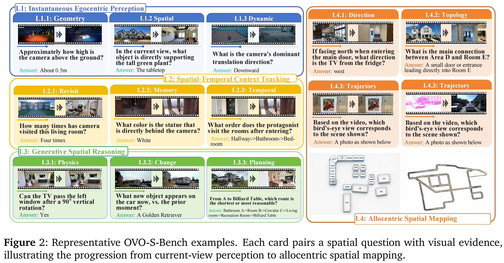
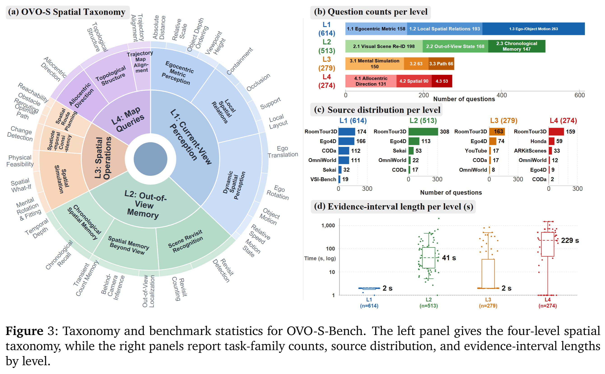
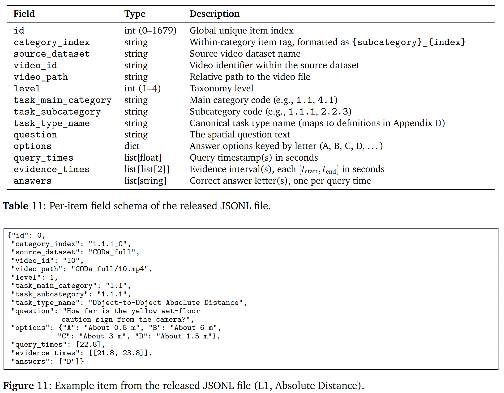
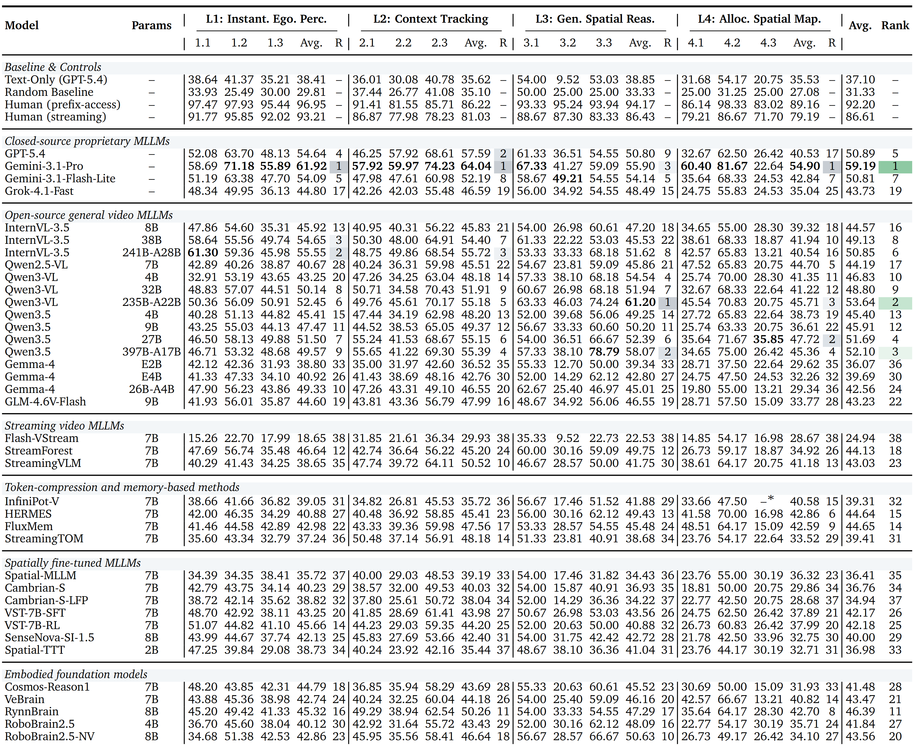
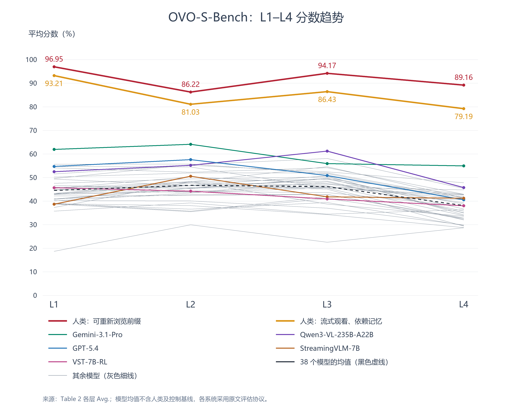
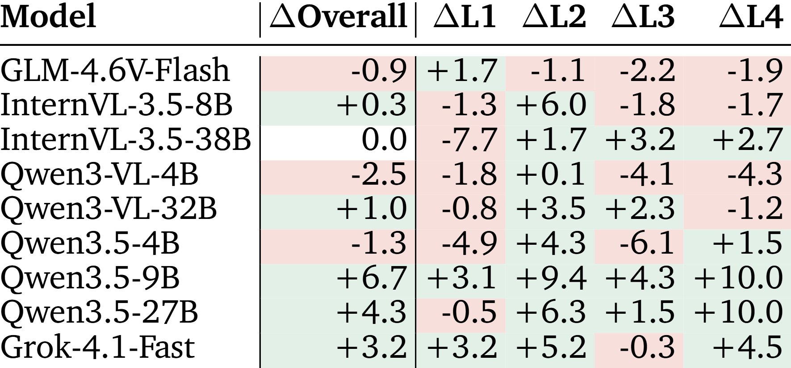
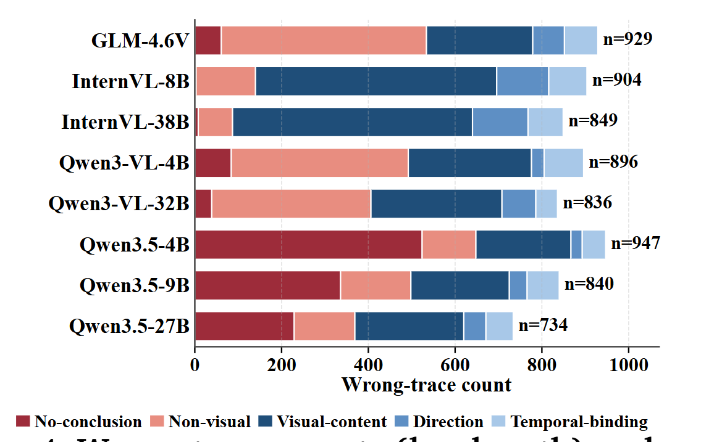
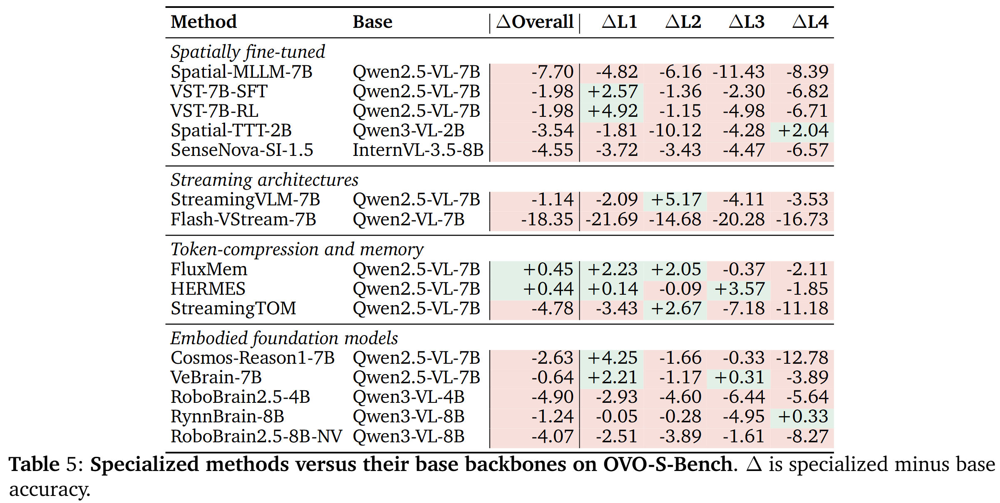
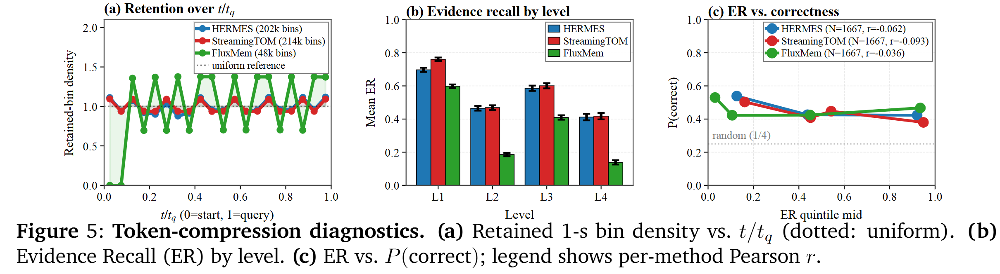

## 论文信息

[OVO-S-Bench: A Hierarchical Benchmark for Streaming Spatial Intelligence in Multimodal LLMs](https://arxiv.org/abs/2606.03890)

- **作者：** Yifei Li、Pengyiang Liu、Yuhang Zang、Zhongyue Shi、Qi Fu、Hongye Hao、Jiwen Lu
- **机构：** Tsinghua University,  Shanghai AI Laboratory,  Beihang University
- **会议：** EMNLP 2026；[项目页面](https://internlm.github.io/OVO-S-Bench/)标注为 Oral。
- **项目页面：** [OVO-S-Bench](https://internlm.github.io/OVO-S-Bench/)
- **代码：** [InternLM/OVO-S-Bench](https://github.com/InternLM/OVO-S-Bench)
- **数据：** [JoeLeelyf/OVO-S-Bench](https://huggingface.co/datasets/JoeLeelyf/OVO-S-Bench)


## 1. 文章结构

| 部分 | 回答的问题 |
| --- | --- |
| §1 引言 | 为什么已有空间基准和视频理解基准仍不足以评估流式空间智能 |
| §2 相关工作 | 空间理解、空间增强模型和流式视频模型分别覆盖了什么 |
| §3.1 四层任务体系 | 从当前画面到全局空间结构，应当区分哪些能力 |
| §3.2–3.3 数据构建与统计 | 如何选视频、写问题、标注证据并控制语言捷径 |
| §4.1–4.2 评估设置与主结果 | 不同模型如何接收视频，与人类存在多大差距 |
| §4.3 诊断实验 | 思考模式、采帧策略、空间微调和记忆压缩是否有效 |
| §5 结论与局限 | 基准揭示了什么，又有哪些具身能力尚未测量 |
| 附录 A–C | 模型规模、采帧敏感性、思维链错误分析 |
| 附录 D–H | 任务边界、标注流程、基准比较、推理设置与响应类型 |
| 附录 I–K | 开放式回答试验、后续方向与更多题目示例 |

## 2. 引言与相关工作

### 2.1 现有工作调研

作者从“空间理解Benchmark”、“多模态模型”以及“流式视频理解”，三个角度进行调研。

| 调研方向 | 子类别 | 代表研究工作 | 主要关注点 |
| --- | --- | --- | --- |
| 空间理解 Benchmark | 通用空间理解与推理 | TopViewRS、MMSI-Bench、VSI-Bench、STI-Bench、MMSI-Video-Bench、DSI-Bench；层级化评估包括 SpatialTree、SpatialBench | 覆盖静态、多图及视频中的度量感知、空间关系、多视角整合与动态空间理解；多数采用静态或离线上下文 |
|  | 具身与自我中心空间任务 | OpenEQA、EmbSpatial-Bench、Open3D-VQA、DisJoint-3DQA | 关注具身场景中的空间关系、情景记忆、主动探索，以及非共视对象之间的空间推理 |
| 空间多模态模型 | 数据与训练策略增强 | VST（Visual Spatial Tuning）、SenseNova-SI、Holi-Spatial | 扩展空间监督数据，结合监督微调、强化学习或从视频中挖掘空间监督，增强感知与推理能力 |
|  | 架构与空间表征增强 | SpatialVLM、Spatial-MLLM、SpaceMind | 分别通过空间信息监督、专用空间 token、相机引导的模态融合等方式，引入空间或几何信息 |
|  | 推理时适配与增强 | Cambrian-S、Spatial-TTT | 在推理阶段调整视频消费和空间状态维护方式，包括预测式世界建模、主动记忆管理，以及测试时快速权重更新；不统一等同于无训练方法 |
| 长视频与流式视频理解 | 长视频理解 Benchmark | EgoSchema、LongVideoBench、LVBench | 评估长时序内容理解、跨片段信息整合与历史检索，通常采用离线访问协议 |
| 长视频与流式视频理解 | 流式视频理解 Benchmark | StreamingBench、OVBench、OVO-Bench、OST-Bench、SVCBench；相关具身流式评估包括 StreamEQA | 在查询时限制未来信息访问，评估实时问答、历史回忆、响应时机、在线场景理解或持续计数 |
|  | 历史记忆与输入压缩优化 | Streaming Long Video Understanding with Large Language Models、Flash-VStream、TimeChat-Online、StreamForest、HERMES、StreamingTOM、FluxMem | 通过记忆库、视觉 token 剪枝、KV 缓存管理、事件分段及层级记忆，在有限资源下保留历史；主要面向语义与事件信息，空间结构保真仍需验证 |

### 2.2 现有工作局限性

核心局限：

> No existing benchmark bridges this gap: spatial evaluation remains tied to fragmented, discrete-frame perception, while streaming evaluation targets semantic and event recall, leaving continuous spatial reasoning from egocentric video untested

现有基准要么做“空间”但不做“流式”，要么做“流式”但不做“空间”，两者的交集——**连续第一人称视频流中的空间推理**——此前没有被系统评测。

- **以静态/离线上下文为假设：** 模型再评估时可以在查询时重新关注任意帧，缺少流式约束，难以检验证据离开视野后的持续空间记忆
- **第一人称问答基准：** 具身智能等以自我为中心的任务多为第一人称视角，其评估基准仍主要在经过组织的上下文中评估，尚未充分检验连续因果视频流中任意查询时刻的空间状态维护
- **长视频/流式基准：** 偏向事件、语义或交互，而非空间结构
- **Streaming MLLM 方法：** 主要围绕事件记忆设计，能否保留并使用长期空间证据尚不清楚

## 3. OVO-S-Bench 介绍

（吐槽）：好工作，但是名字擦边 OVO-Bench 有点抽象。

### 3.1 任务定义



论文按查询时需要访问和操作的空间状态，将问题划分为四层，每层包含三个任务族，共 30 种规范任务类型。（§3.1、附录 D）

| 层级 | 需求与核心问题 | 三个任务族 | 典型例子 |
| --- | --- | --- | --- |
| **L1 即时自我中心感知** | 当前观察：当前视野中的空间结构是什么 | 自我中心度量感知；局部空间关系；动态空间感知 | 相机离地多高，植物由什么支撑，相机正在向下还是向前移动 |
| **L2 时空上下文跟踪** | 历史记忆：看过但已不在视野中的空间信息是什么 | 场景重访识别；视野外空间记忆；时序空间记忆 | 客厅来过几次，刚才的雕像在当前相机的哪个方向，房间按什么顺序经过 |
| **L3 生成式空间推理** | 空间想象：对空间状态进行操作后，会得到什么结果 | 空间模拟；时空一致性验证；空间路径规划 | 电视旋转后能否穿窗，前后观察有哪些变化，避开某条通道后如何到达目标 |
| **L4 非自我中心空间建图** | 全局整合：跨视角整合后的全局布局是什么 | 全局方向推理；拓扑结构推理；轨迹—地图对齐 | 厨房在客厅的哪个方位，哪些房间直接连通，走过的路线对应哪张俯视图 |

#### 与[空间智能综述](/blog/论文阅读-Spatial-intelligence-in-vision-language-models-a-comprehensive-survey/)三层分类的关系

空间智能综述采用“感知—理解—外推”，OVO-S-Bench 则进一步强调历史证据和全局空间整合。两者可以建立概念联系，但没有严格的一一对应关系。

| 综述中的类别 | 与 OVO-S-Bench 的联系 | 需要区分的地方 |
| --- | --- | --- |
| 感知 | 主要关联 L1 | 本文 L1 同时包含局部关系和短时运动 |
| 理解 | 涉及 L1 的关系判断及 L2 的状态保持 | 本文把证据是否离开视野作为重要边界 |
| 外推 | 主要关联 L3，并涉及 L4 的视角转换与整合 | 全局建图不一定是在预测未发生的未来 |

**个人理解：** 这四层更适合用来组织流式空间任务，而不是直接视作已经得到验证的人类认知难度阶梯。L3 的证据区间中位数与 L1 一样短，也说明层级并不等于视频长度或记忆跨度单调增加。

### 3.2 Benchmark构建

Benchmark 的构建细节如下图所示：


#### 数据规模
- 视频数：348 段
- 问题数：1680 个（L1: 614; L2: 513; L3: 279; L4: 274）
- 任务组织： 4 层、12 个任务族、30 种规范任务类型
- 查询时平均可见前缀时长：8.8 min

#### 视频来源

| 场景类型 | 视频来源 |
| --- | --- |
| 室内漫游 | RoomTour3D |
| 第一人称活动 | Ego4D |
| 户外与开放场景 | Sekai、OmniWorld、YouTube walking tours |
| 驾驶场景 | CODa、Honda HDD |
| 带空间信息的三维环境或基准来源 | ARKitScenes、VSI-Bench |

#### 数据格式

对于每个条目，记录视频、任务标签、问题、选项、答案、查询时间戳与证据区间。其中：
- **查询时刻（query timestamp）：** 问题在什么时候提出，决定模型最多能看到哪里。
- **证据区间（evidence interval）：** 判断答案所需证据所在的时间范围，用于人工核查、诊断和 oracle 采样

在数据格式上，该基准以单个 JSONL 文件（ovo_s_bench_l1_l4.jsonl）形式发布，每个条目对应一个 JSON 对象（共 1 680 个条目，覆盖 L1–L4）。字段意义和示例如下。



其中，关于“查询时刻”与“证据区间”在数据中以 `"query_times"` 和 `"evidence_times"` 表示。

**需要注意的是**，Appendix E.6 提到 `"All evidence intervals lie strictly before their corresponding query time, enforcing the online protocol."`，但上面示例中证据区间跨过了查询时刻。

#### 其他

论文还说明了 BenchMark 构建的标注细节和质量控制，对于 BenchMark 的构建具备参考意义，因不涉及相关工作，不做具体说明，仅作标记以供后续相关任务时参考。

## 4. 实验设置

### 4.1 两种评估模式

论文区分两种评估模式，这是理解后续结果的前提。

| 模式 | 视频如何进入模型 | 问题何时可用 | 主要约束 |
| --- | --- | --- | --- |
| **前缀访问（prefix-access）** | 默认从完整历史前缀均匀采样 128 帧，与问题一起输入 | 回答时与采样帧一起提供 | 禁止未来信息，但模型可结合问题在输入帧之间自由注意 |
| **流式处理（streaming）** | 按各模型原生速率顺序输入，通过记忆或压缩状态保留历史 | 历史处理和记忆决策完成后才到来 | 记忆维护不能预先针对当前问题选择证据 |

商业模型、通用视频模型、空间微调模型和具身基础模型主要采用前缀访问；原生流式模型与 token 压缩方法采用流式处理。（§4.1、附录 G.3–G.4）

**注：** 两种模式都满足时间因果约束，但信息访问和记忆负担不同。因此，排行榜是不同系统在各自评估配置下的结果；涉及架构优劣时，还应检查输入预算、历史访问方式和计算成本。

本文在预先指定的查询时刻提出空间问题，考察模型利用当前观察或历史证据作答的能力，**不评估模型自行选择时机的能力**。此外，视频观察路径是预先固定的，模型无法通过移动或转动相机主动补充证据。

### 4.2 模型与人类基线

论文主表评估 38 个系统配置，覆盖六类方法。

| 类别 | 代表模型或方法 |
| --- | --- |
| 商业多模态模型 | GPT-5.4、Gemini-3.1-Pro / Flash-Lite、Grok-4.1-Fast |
| 开源通用视频模型 | InternVL-3.5、Qwen2.5-VL、Qwen3-VL、Qwen3.5、Gemma-4、GLM-4.6V-Flash |
| 原生流式视频模型 | Flash-VStream、StreamForest、StreamingVLM |
| Token 压缩与记忆方法 | InfiniPot-V、HERMES、FluxMem、StreamingTOM |
| 空间微调或空间适配模型 | Spatial-MLLM、Cambrian-S、VST-SFT / RL、SenseNova-SI、Spatial-TTT |
| 具身基础模型 | Cosmos-Reason1、VeBrain、RynnBrain、RoboBrain2.5 |

控制基线包括随机作答、仅输入题目和选项的 GPT-5.4，以及五名独立参与者完成的人类评估。具体来说：
- **随机基线（Random Baseline）:** 利用视频或问题内容，在可选答案中等概率随机选择时的期望准确率，用来作为“靠猜能得到多少分”的参照。(不是25%的原因，因为不同题目的选项数量不同，论文又按任务和层级汇总成绩)
- **纯文本基线（Text-Only Baseline）:** 模型利用语言或选项线索等达到的分数。
- **Human（prefix-access）：** 受测者获得问题后可以查看和重新浏览视频前缀。
- **Human（streaming）：** 受测者观看时不知道问题，问题出现后依靠记忆作答。

普通前缀访问模型应主要与前一种人类基线比较；原生流式和压缩方法主要与后一种比较。

## 5. 实验结果与分析



### 5.1 实验观察

最优系统 Gemini-3.1-Pro 为 59.19，与同属前缀访问模式的人类 92.20 相差约 **33.0 个百分点**；与约束更强的人类流式基线相比则相差约 27.4 个百分点。后者不能写成严格相同访问条件下的人机差距。

开源模型也不是在所有任务上都弱于商业模型：Qwen3-VL-235B-A22B 在 L3 得到 61.20，高于 Gemini-3.1-Pro 的 55.90。

**前提：** 论文支持的是整体能力仍不足、优势随任务变化，而不是单一模型在所有空间能力上占优。

### 5.2 L4 是最集中的瓶颈，但能力排序并不严格逐层下降

这与 [空间智能综述](/blog/论文阅读-Spatial-intelligence-in-vision-language-models-a-comprehensive-survey/) 的发现的现象一致，这也让我对 **“以人类启发的任务分类”** 的合理性产生了更进一步的怀疑。

实际上，如果我们观察人类的两次实验：

| 人类评估模式 | L1 | L2 | L3 | L4 | 排序 |
| --- | ---: | ---: | ---: | ---: | --- |
| 可重访 | 96.95 | 86.22 | 94.17 | 89.16 | **L1 > L3 > L4 > L2** |
| 依赖记忆 | 93.21 | 81.03 | 86.43 | 79.19 | **L1 > L3 > L2 > L4** |

可以发现： **L1、L3 高于 L2、L4；L2 与 L4 的相对位置随访问条件变化。**

将模型和人类在 L1-L2-L3-L4 的分数趋势如下图表示出来。



发现从 L1 到 L2 任务得分上出现了分化：人类明显下降，模型却得分上涨，个人认为这与人与模型的记忆机制是不一样的原因有关。

### 5.3 思考模式的收益取决于模型和任务



Table 3 对九组思考与非思考配置进行比较：

- L2 平均提升 **3.9 个百分点**，九组中八组为正，说明显式推理可能有助于跨帧信息整合。
- L1 平均下降 **1.0 个百分点**，九组中六组为负，说明局部空间感知未必受益于更长推理。
- 模型差异明显：Qwen3.5-9B 总分提升 6.7，而 Qwen3-VL-4B 下降 2.5；收益不能简单由参数量解释。

Figure 4 中，作者进一步分析了八个思考模型的错误轨迹，将问题分为无法输出结论、脱离视觉的先验推断、视觉内容错误、方向错误和时间绑定错误。其中：

- InternVL3.5 系列在开启思考后受视觉内容错误影响严重，对具体画面中的物体、属性或关系作出错误陈述，并以此支持答案。
- Qwen3-VL 系列在开启思考后受非视觉错误影响严重，即非常依赖常识、场景惯例或语言先验，没有用具体视觉证据支持判断。
- Qwen3.5 整个系列更容易受到 “雷霆大思考” 的影响，而且参数量越少越容易出现。



**猜测：**

- 推理可能帮助梳理事件，从而改善与记忆相关的任务（L2 时空上下文跟踪、L4 非自我中心空间建图）。
- 推理可能放大初次观察产生的错误（L1 即时自我中心感知）。
- 随着思考过程延长，视觉 embedding 对模型结果的影响可能逐渐降低（L1 即时自我中心感知）。


### 5.4 增加帧数或提供证据区间提升不高

作者比较了查询时刻单帧、最近 16 帧短窗口、历史前缀均匀采样 32/64/128/256 帧、偏重近期内容的 log-128，以及只在人工证据区间内采样的 oracle。（§4.3.2、附录 B）

以下为 Table 4 的五模型子集，总分单位为百分比；该敏感性实验的 U-128 数字与主表存在小幅差异，不与主表混用。

| 模型 | U-128 | U-256 | log-128 | oracle-evidence |
| --- | ---: | ---: | ---: | ---: |
| Gemini-3.1-Flash-Lite | 50.88 | 48.33 | 48.55 | 49.70 |
| Qwen3-VL-32B | 48.71 | 48.93 | 51.40 | 48.80 |
| Qwen3.5-27B | 51.56 | 50.64 | 51.74 | 51.87 |
| VST-7B-RL | 42.13 | 41.99 | 44.35 | 42.13 |
| RoboBrain2.5-NV-8B | 43.56 | 43.87 | 46.84 | 43.56 |

在这五个模型中，oracle 相对 U-128 的最大提升约 0.3 个百分点，帧数翻倍也没有稳定增益。短窗口对 L1 更有利，但可能损害需要历史整合的 L4。

### 5.5 空间特化与流式方法没有稳定超过底座

在 Table 5 的 15 组方法与底座比较中，13 组总分下降，L4 同样有 13 组下降，平均变化约为 **−6.1 个百分点**。HERMES 和 FluxMem 的总分仅略高于底座，分别约 +0.4 和 +0.5。

部分方法在 L1 改善，却在 L4 退步。例如 VST-7B-RL 的 L1 相对底座增加约 4.9，L4 下降约 6.7。这提示局部空间监督、事件记忆或动作任务上的增强，未必迁移到长程全局空间结构。



与 [空间智能综述](/blog/论文阅读-Spatial-intelligence-in-vision-language-models-a-comprehensive-survey/) 的发现的现象一致，在此不做过多分析。

### 5.6 保留了历史证据不代表能够正确使用

作者对 HERMES、StreamingTOM、FluxMem 记录每次查询时仍保留哪些视频时刻，定义 **Evidence Recall（ER）**：人工证据区间中有多少时间范围在压缩后仍被保留。

$$
\mathrm{ER}
=
\frac{\text{证据区间内仍被保留的时间单元数量}}
{\text{证据区间包含的时间单元总数}}
$$

文章使用 **1 秒时间单元（1-s bins）** 进行保留情况统计。例如：

- 证据区间覆盖 10 个一秒时间单元；
- 压缩后，记忆仍保留其中 4 个时间单元对应的信息；
- 则 ER 为 \(4/10=0.4\)。



L4 的平均 ER 约为 0.14–0.42，低于 L1 的约 0.60–0.76，说明记忆压缩确实会丢弃长程任务需要的证据；但在这三种方法中，逐题 ER 与正确率的线性相关性很弱。（§4.3.3）


## 6. 复现时发现的问题

### 6.1 数据差异

论文主结果使用 **1,680** 道题，而当前公开版有 **1,695** 道题。其中额外增加了15道L1题。作者没有公开1,680题的ID清单或对应筛选脚本。

| 数据范围 | L1 | L2 | L3 | L4 | 总数 |
| --- | --- | --- | --- | --- | --- |
| 论文主结果集 | 614 | 513 | 279 | 274 | 1,680 |
| 当前公开数据（唯一题目） | 629 | 513 | 279 | 274 | 1,695 |
| 当前公开数据（评分查询） | 629 | 540 | 279 | 274 | 1,722 |

公开版相对论文主结果集增加了 15 道 L1 题，其中：

- L1.1 自我中心度量感知增加 9 题；
- L1.2 局部空间关系增加 1 题；
- L1.3 动态空间感知增加 5 题。

L2 从 513 变为 540 并不代表增加了 27 道新题，而是 `Revisit Counting` 任务中 78 道唯一题目被展开为 105 个查询，因此额外产生 27 个评分实例。

### 6.2 计分差异

论文先计算 12 个任务族的准确率，再对每层的三个任务族等权平均，最后对 L1 到 L4 四层等权平均。项目自带的评分脚本则直接对全部 1,722 个查询做微平均。

另外，公开评分脚本目前只识别 A 到 E，但数据中存在 F 和 G 选项，会把部分正确答案误判为错误。

#### 附：微平均和宏平均之间的差距

设第 \(i\) 个任务族有 \(n_i\) 道题，答对 \(c_i\) 道，准确率为 \(a_i=c_i/n_i\)。共有 \(K\) 个任务族，总题量为 \(N=\sum_i n_i\)。那么有：

\[
A_{\text{微}}
=\frac{\sum_i c_i}{N}
=\sum_{i=1}^{K}\frac{n_i}{N}a_i,
\qquad
A_{\text{宏}}
=\frac{1}{K}\sum_{i=1}^{K}a_i.
\]

两式相减，就能直接看到差异来自哪里：

\[
A_{\text{微}}-A_{\text{宏}}
=\sum_{i=1}^{K}
\underbrace{\left(\frac{n_i}{N}-\frac1K\right)}_{\text{该任务族在微平均中多占或少占的权重}}
a_i.
\]

题量多的任务族如果恰好准确率也高，微平均就倾向于更高；如果题量多的任务族准确率偏低，微平均就倾向于更低。

### 6.3 环境差异

结果文件没有记录 GPU 型号（论文声称 H800 和 H200）、vLLM 和 Transformers 具体版本、模型权重提交号以及视频解码库版本，所以只能确认主要推理参数基本对齐，不能认为软件和硬件环境完全一致。复现时，采用默认脚本有可能需要修改。例如，在复现 InternVL 时报错如下：

```text
Batch inference error:
InternVLChatVideoProcessor.__init__() got an unexpected keyword argument
'max_dynamic_patch'

Single-item fallback also failed:
... unexpected keyword argument 'max_dynamic_patch'
```

在 `models/internvl_models.py` 中修改 `hf_overrides`：

```python
hf_overrides = {
    "max_dynamic_patch": self.max_dynamic_patch,
}
```

并删除：

```python
mm_processor_kwargs={"max_dynamic_patch": self.max_dynamic_patch},
```

## 7. 总结

OVO-S-Bench 面向连续第一人称视频中的空间智能，构建了从即时感知、历史空间记忆、空间操作到全局建图的四层任务体系，并通过查询时间戳和人工证据区间，将空间评估置于禁止访问未来信息的条件下。

论文的主要价值在于把“看过视频”与“形成可持续使用的空间状态”区分开：受测模型在全局空间建图上普遍较弱，思考模式、增加采样帧和已有空间特化方法也未带来稳定改善，为空间记忆、几何表征和证据约束推理提供了诊断依据。

但不同模型的信息访问模式、题型与数据来源并未完全对齐，现有诊断也不足以将失败归结到单一机制。后续更有价值的问题是：在受控的输入和计算预算下，如何同时保留空间证据、维持跨视角一致性，并让这些信息真正支持回答与规划。
