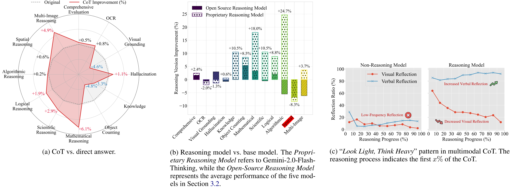
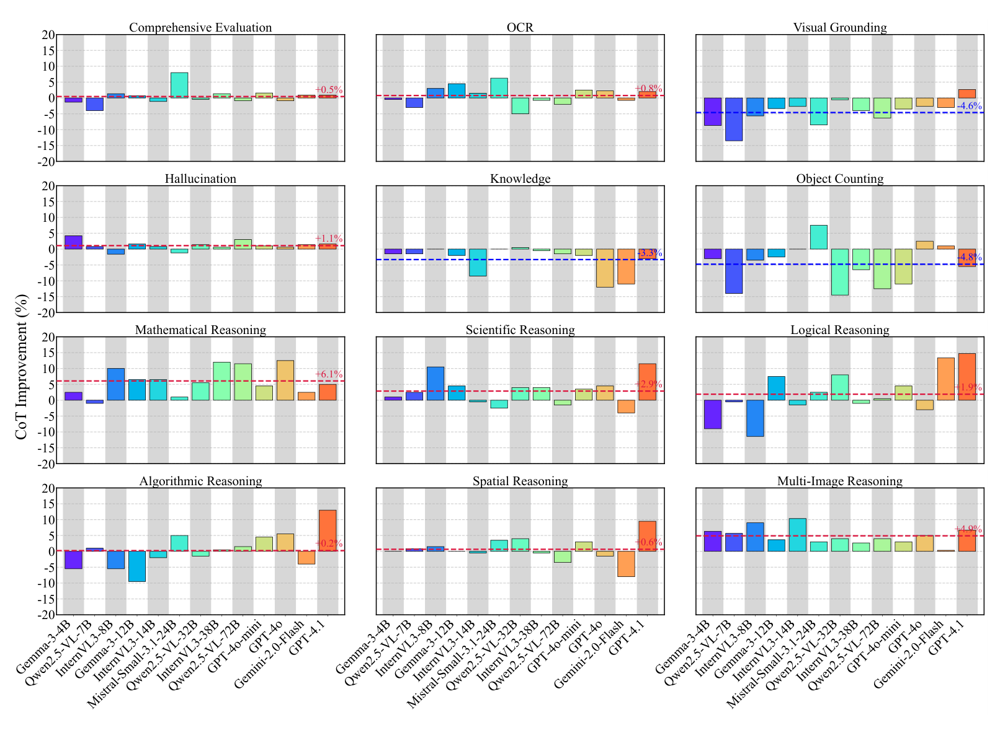
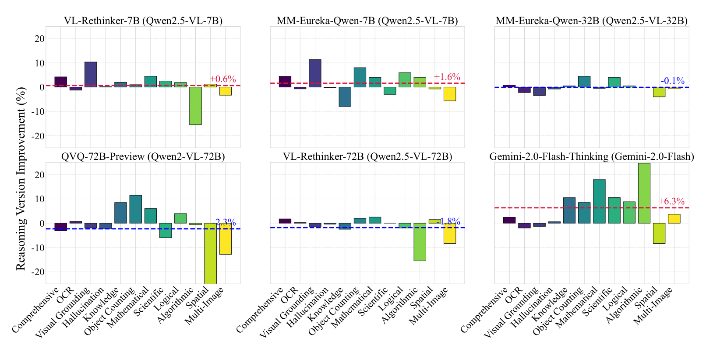
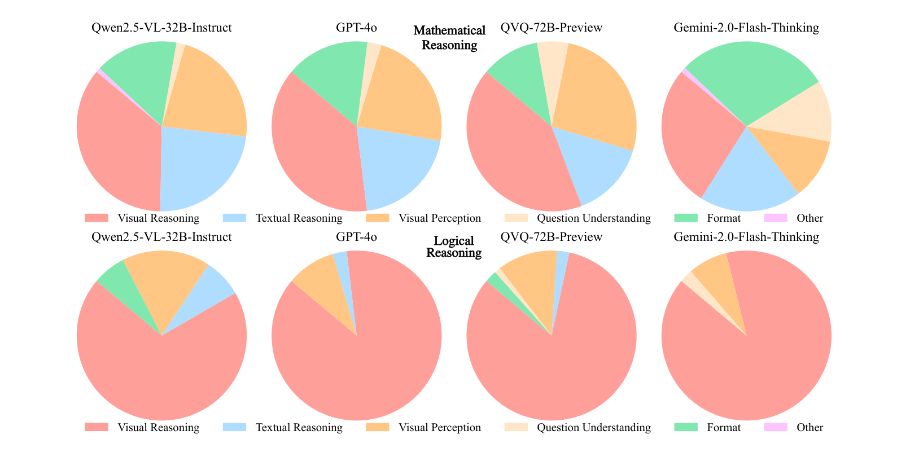
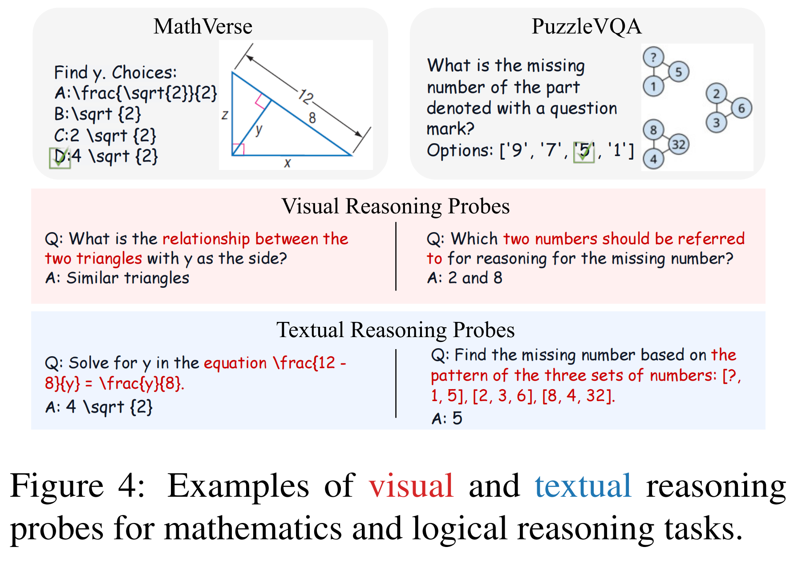
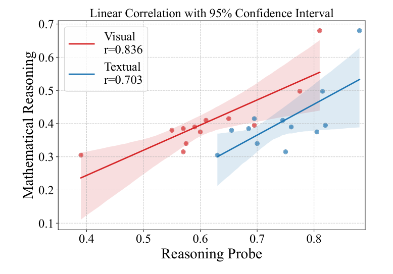
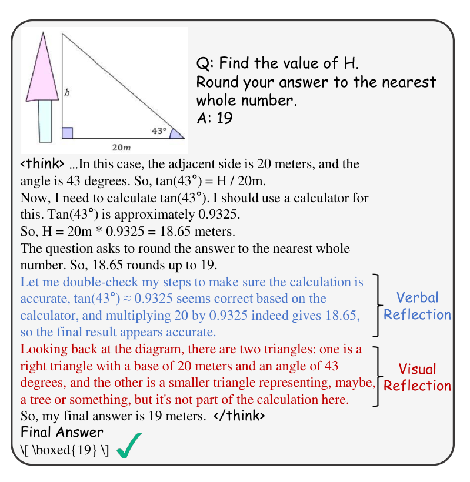
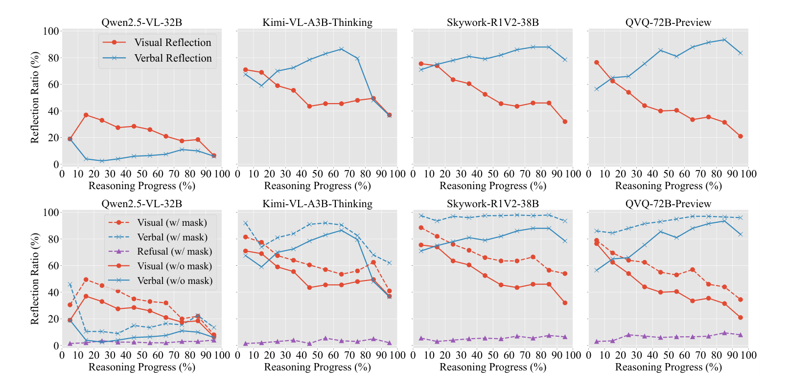
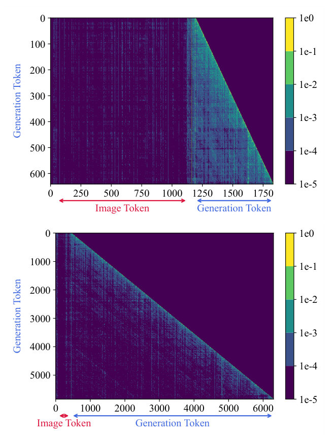

## 论文信息

Look Light, Think Heavy: What Multimodal Chain-of-Thought Reasoning Can and Cannot Do

- **作者：** Zhuoran Jin、Kejian Zhu、Hongbang Yuan、Yupu Hao、Pengfei Cao、Yubo Chen、Kang Liu、Jun Zhao
- **机构：** 中国科学院自动化研究所 复杂系统认知与决策智能实验室；中国科学院大学人工智能学院
- **会议：** ACL 2026（Volume 1: Long Papers），pp. 8567–8608
- **代码 / 项目页面：** 暂无

> **阅读动机：** 在阅读 [OVO-S-Bench](/blog/论文阅读-OVO-S-Bench_A-Hierarchical-Benchmark-for-Streaming-Spatial-Intelligence-in-Multimodal-LLMs/) 时，注意到推理模型在定位等任务上有时弱于非推理模型，也提出了一些[猜测](/blog/论文阅读-OVO-S-Bench_A-Hierarchical-Benchmark-for-Streaming-Spatial-Intelligence-in-Multimodal-LLMs/#个人猜测)。这篇论文提供了另一组实验，可以用来对照这些现象，看看哪些猜测得到了支持。

## 中文摘要

本文在 12 类多模态感知与推理任务上评估了 14 个非推理模型和 8 个推理模型。对非推理模型显式提示思维链（CoT）时，数学、科学和多图推理通常受益，视觉定位与物体计数则可能退化。将开源推理模型与各自的基座模型比较时，整体收益通常有限，且同一任务在两种实验设置下可能呈现不同趋势。反思分析和注意力可视化显示，在作者分析的长思维链中，模型对视觉输入的复查减少，注意力也逐渐偏向已生成的推理文本。作者将这种现象称为「看得浅、想得重」（Look Light, Think Heavy）。

## 1. 文章结构

| 部分 | 回答的问题 |
| --- | --- |
| §1 引言 | 多模态 CoT 能做什么、不能做什么，以及原因；提出 RQ1–RQ3 |
| §2 问题定义 | CoT 与直接作答如何定义，任务怎样分为感知与推理两类，评估哪些模型 |
| §3.1 直接作答 vs. CoT（RQ1） | CoT 在 12 类任务上分别带来多少增益或损失 |
| §3.2 基座模型 vs. 推理模型（RQ2） | 经 RLVR 等训练得到的推理模型是否全面优于对应基座 |
| §4.1 视觉推理瓶颈（RQ3） | 错误主要来自哪里；视觉推理与文本推理子问题哪个更难、与总分更相关 |
| §4.2 反思行为 | 视觉反思与语言反思在推理过程中如何分布；遮挡关键信息后能否拒答 |
| §4.3 注意力偏置 | 长 CoT 生成过程中，注意力在视觉 token 与推理 token 间如何分配 |
| §5–6 相关工作与结论 | 与 CoT、多模态推理、Thinking with Image 的关系 |
| 局限与展望 | 数据集与模型覆盖范围；视觉反思与外部工具两个方向 |
| 附录 A–C | 12 类任务的数据来源与示例、模型与提示词、探针生成与校验提示词 |
| 附录 D–F | 实现细节与错误类型定义、补充结果（反思分布、相关性、注意力图）、o3 案例 |

## 2. 引言与相关工作

### 2.1 研究动机

多模态 CoT 的研究和评测主要集中在数学推理（MathVista、MathVerse、MATH-Vision 等），而多模态任务远不止数学推理。CoT 会带来额外推理开销，它能否在更广泛的多模态任务上稳定提升表现，仍是开放问题。

围绕核心问题 “What can multimodal Chain-of-Thought reasoning do, and where and why does it fall short?”，论文拆分为三个研究问题：

| 研究问题 | 内容 |
| --- | --- |
| **RQ1** | 多模态 CoT 在感知和推理任务上分别能做什么、不能做什么 |
| **RQ2** | 多模态推理模型能否通过测试时扩展（test-time scaling）超过基座模型 |
| **RQ3** | 限制多模态 CoT 效果的关键因素是什么 |

### 2.2 相关工作

| 方向 | 代表工作 | 论文的定位 |
| --- | --- | --- |
| Chain-of-Thought | CoT、Self-Consistency、Zero-shot CoT、Least-to-Most；s1、LIMO 等测试时扩展；Multimodal-CoT、CCoT、Visual Sketchpad、MME-CoT | Sprague et al.（To CoT or not to CoT）在文本领域发现 CoT 增益因任务而异；多模态 CoT 仍缺少系统分析 |
| 多模态推理模型 | LLaVA-o1、R1-Onevision、MM-Eureka、OpenVLThinker、VL-Rethinker、VLM-R1、X-Reasoner | 主要在数学推理和长 CoT 上取得提升，多数缺少更广泛多模态任务上的验证 |
| Thinking with Image | GRIT、Pixel Reasoner、MVoT、DeepEyes、VGR、PyVision、Visual-ARFT 等 | 把视觉模态引入推理过程，通过裁剪、缩放等工具或代码操作图像 |

## 3. 实验设置

### 3.1 CoT 与直接作答的形式化

给定图像集合 $$I$$、问题 $$q$$：

- **CoT：** $$r, a = M(I, p_c, q)$$，其中 $$r$$ 为推理过程，$$a$$ 为答案。$$p_c$$ 形如 “Please first think about the reasoning process as an internal monologue and then provide the final answer.”，并要求推理放在 `<think></think>` 中、答案放在 `\boxed{}` 中。
- **直接作答：** $$a = M(I, p_d, q)$$，$$p_d$$ 形如 “Please generate the answer directly.”。

### 3.2 任务与数据

12 类任务分为感知和推理两组，每个数据集抽取 150–250 题（附录 A、Table 1）。可以看到，针对任务的评估数据其实并不多，不过该论文是 empirical analysis 性质论文，不做过多评判。

| 类别 | 任务 | 数据来源（样本数） |
| --- | --- | --- |
| 感知 | 综合评估 | MME (200)、MMStar (200)、MMT-Bench (200) |
|  | OCR | TextVQA (200)、OCRBench (200) |
|  | 视觉定位 | RefCOCO (150)、RefCOCOg (150) |
|  | 幻觉检测 | HallusionBench (250)、POPE (250) |
|  | 知识型 VQA | A-OKVQA (200) |
|  | 物体计数 | Super-CLEVR (200) |
| 推理 | 数学推理 | MathVerse (200) |
|  | 科学推理 | MMMU (200) |
|  | 逻辑推理 | PuzzleVQA (200) |
|  | 算法推理 | AlgoPuzzleVQA (200) |
|  | 空间推理 | SpatialEval (200) |
|  | 多图推理 | MUIRBench (200) |

### 3.3 模型

| 类别 | 模型 |
| --- | --- |
| 非推理模型（14 个） | Qwen2.5-VL-7B/32B/72B-Instruct、Qwen2-VL-72B-Instruct、InternVL3-8B/14B/38B、Gemma-3-4B/12B、Mistral-Small-3.1-24B-Instruct、GPT-4o-mini、GPT-4o、GPT-4.1、Gemini-2.0-Flash |
| 推理模型（8 个） | VL-Rethinker-7B/72B、MM-Eureka-7B/32B（基于 Qwen2.5-VL）、QVQ-72B-Preview（基于 Qwen2-VL）、Skywork-R1V2-38B、Kimi-VL-A3B-Thinking、Gemini-2.0-Flash-Thinking（基于 Gemini-2.0-Flash） |

实现细节（附录 B、D）：

- 开源模型使用 vLLM 推理，硬件为 4×A100 80GB；
- 所有模型温度设为 0.7，统一采用 performance@1（单次采样）；
- 提示词按任务类型区分；模型有专用提示词时保留原设计，否则使用统一模板。

## 4. 实验结果与分析

下图，重点关注 **图(a)** 和 **图(b)** 与 **广义空间智能** 相关的几个指标（如图Spatial Reasoning、Object Counting、Visual Grounding、Multi-Image Reasoning）。需要做区分的是，图(a)对于基模采用提示式CoT，图(b)采用的是推理模型。这使得同一个指标之间表现可能会相反（如Spatial Reasoning、Object Counting）。

### 总览

论文的三个研究问题层层递进。RQ1 和 RQ2 是现象层面的比较，回答 CoT 和推理模型在哪些任务上有效；RQ3 解释原因，先由错误分析与探针实验确定瓶颈在视觉推理，再从外部行为（反思）和内部机制（注意力）两个角度刻画这一瓶颈。

| 研究问题 | 比较 / 实验 | 模型与数据 | 主要结论 |
| --- | --- | --- | --- |
| **RQ1** CoT 在感知与推理任务上能做什么、不能做什么 |直接作答（"Please generate the answer directly."） vs. CoT（"Please first think about the reasoning process as an internal monologue..."）| 14 个非推理模型，12 类任务 | 数学（+6.1）、多图（+4.9）、科学（+2.9）推理稳定受益；视觉定位（−4.6）、计数（−4.8）、知识型 VQA（−3.3）下降；逻辑、算法推理的效果随模型规模变化 |
| **RQ2** 推理模型能否通过测试时扩展超过基座 | 推理模型 vs. 对应基座 | 5 个开源推理模型 + Gemini-2.0-Flash-Thinking，12 类任务 | 开源推理模型平均变化在 −2.3 到 +1.6 之间，增益有限；Gemini-2.0-Flash-Thinking 平均 +6.3，算法推理 +24.7 |
| **RQ3-1** 错误主要来自哪里 | 人工错误分析；视觉 / 文本推理探针 | 4 个模型的错误分析；多个模型的探针测试，仅数学（MathVerse）和逻辑（PuzzleVQA） | 视觉推理错误占比最大；视觉探针准确率比文本探针低约 20%，且与原任务分数相关性更高 | §4.3（补注见 §4.3.3） |
| **RQ3-2** 推理过程中的反思行为如何分布 | GPT-4.1 对 CoT 分 10 段标注视觉 / 语言反思；马赛克遮挡关键信息 | Qwen2.5-VL-32B 与 3 个推理模型；MathVista 等 | 语言反思先升后降，视觉反思持续下降（Look Light, Think Heavy）；遮挡后反思增多，但很少拒答 |
| **RQ3-3** 内部注意力在推理过程中如何分配 | 长 CoT 生成时的注意力可视化 | Kimi-VL-A3B-Thinking，附录另有 3 个 Qwen3 系列模型；数学与逻辑推理 | 注意力逐渐集中到推理 token，视觉 token 被忽视 |

### 4.1 RQ1：CoT 不是“免费午餐”

14 个非推理模型在各任务上 CoT 相对直接作答的平均增益（Figure 1a / Figure 2，单位为百分点）：

| 感知任务 | 平均增益 | 推理任务 | 平均增益 |
| --- | ---: | --- | ---: |
| 综合评估 | +0.5 | 数学推理 | **+6.1** |
| OCR | +0.8 | 科学推理 | **+2.9** |
| 视觉定位 | **−4.6** | 逻辑推理 | +1.9 |
| 幻觉检测 | +1.1 | 算法推理 | +0.2 |
| 知识型 VQA | **−3.3** | 空间推理 | +0.6 |
| 物体计数 | **−4.8** | 多图推理 | **+4.9** |

论文据此得出的结论：

- **感知任务：** CoT 收益很小甚至为负，视觉定位、知识型 VQA 和物体计数平均分别下降 4.6、3.3、4.8 个百分点。作者认为原因可能是 CoT 引入了感知任务不需要、甚至会造成干扰的推理步骤。
- **数学、科学推理：** 提升与 LLM 中观察到的类似。作者认为这类任务在基本视觉理解之后，主要依赖以文本为主的推理。
- **多图推理：** 平均提升 4.9 个百分点。作者观察到模型倾向于在 CoT 中先逐张描述图像，再基于汇总的文字描述进行推理。
- **逻辑、算法推理：** 这两类任务更依赖对视觉信息的推理，CoT 的效果与模型规模密切相关：大模型受益，小模型收益有限甚至下降。

> **Takeaway 3.1.1：** CoT is not a free lunch and should be applied selectively according to the type of multimodal task.

> **Takeaway 3.1.2：** For logical and algorithmic reasoning, the effectiveness of CoT varies with model scale.

附录 A 给出了各任务的直接作答与 CoT 对比示例。例如物体计数任务中，Qwen2.5-VL-7B-Instruct 在 CoT 中逐个列举物体，得出 7 个，直接作答则给出正确答案 9 个（Figure 15）。

**注意**，这个结论的得出是基于“显式CoT”，从论文标题和 Takeaway 写的是笼统的 "multimodal CoT"，表述上过于泛化。

### 4.2 RQ2：开源多模态推理模型的整体增益有限

论文比较了 5 个开源推理模型和 1 个商业推理模型与各自基座的差异。按 Figure 3 中标注的 12 类任务平均变化（读图，单位为百分点）：

| 推理模型（基座） | 平均变化 |
| --- | ---: |
| VL-Rethinker-7B（Qwen2.5-VL-7B） | +0.6 |
| MM-Eureka-Qwen-7B（Qwen2.5-VL-7B） | +1.6 |
| MM-Eureka-Qwen-32B（Qwen2.5-VL-32B） | −0.1 |
| QVQ-72B-Preview（Qwen2-VL-72B） | −2.3 |
| VL-Rethinker-72B（Qwen2.5-VL-72B） | −1.8 |
| Gemini-2.0-Flash-Thinking（Gemini-2.0-Flash） | **+6.3** |

- 开源推理模型在多数任务上的变化幅度不大，其中 QVQ-72B-Preview 和 VL-Rethinker-72B 在空间推理上出现明显下降（Figure 3）。
- Gemini-2.0-Flash-Thinking 在多类推理任务上提升明显，算法推理提升 **24.7** 个百分点（Figure 1b）。
- 作者给出的可能解释：开源推理模型主要以 RLVR 在数学题上训练，侧重数学推理，忽视了更广泛的推理能力；因此可能需要探索新的 MLLM 训练范式。

> **Takeaway 3.2.1：** Existing open-source multimodal reasoning models show modest gains across a range of tasks.

### 4.3 RQ3-1：视觉推理是多模态 CoT 的主要瓶颈

#### 4.3.1 错误分析

作者人工将 CoT 失败案例分为六类（附录 D）：

| 错误类型 | 定义 |
| --- | --- |
| 视觉推理错误 | 正确感知了视觉内容，但基于视觉证据的推理出错 |
| 文本推理错误 | 视觉解读正确，但在文本推理阶段出错，如算术或符号运算错误 |
| 视觉感知错误 | 误读或忽略关键视觉元素，如遗漏细粒度属性 |
| 问题理解错误 | 未理解问题意图或约束 |
| 格式错误 | 输出不符合要求的答案格式 |
| 其他 | 不属于以上类别 |

在 Qwen2.5-VL-32B-Instruct、GPT-4o、QVQ-72B-Preview、Gemini-2.0-Flash-Thinking 四个模型上（Figure 5）：

- 视觉推理错误在两类任务中都占很大比例；
- 在逻辑推理（PuzzleVQA）中，论文称超过 80% 的错误来自对视觉信息的错误推理。

#### 4.3.2 视觉 / 文本推理探针

作者把原题拆成两类中间子问题（Figure 4）：

| 探针类型 | 含义 | 例子（MathVerse / PuzzleVQA） |
| --- | --- | --- |
| **视觉推理探针** | 需要分析和推理视觉信息的中间步骤 | “含边 y 的两个三角形是什么关系？”→ 相似三角形；“推断缺失数字应参考哪两个数？”→ 2 和 8 |
| **文本推理探针** | 不依赖视觉信息、只需文本推理的中间步骤 | “解方程 $$\frac{12-8}{y}=\frac{y}{8}$$”→ $$4\sqrt{2}$$；“根据 [?,1,5]、[2,3,6]、[8,4,32] 的规律求缺失数”→ 5 |

构建与校验流程：

- 使用 o4-mini 生成探针，每题 3 个（附录 C、Table 14–15）；
- 使用 GPT-4.1 按三条标准过滤：正确且唯一、是否依赖视觉、是否为解题的必要中间步骤（Table 16–17）；
- 人工核查 400 个探针样本，数学探针正确率 93.0%，逻辑探针 88.5%。

结果：

| 任务 | 原任务分数与视觉探针的 Pearson r | 原任务分数与文本探针的 Pearson r |
| --- | ---: | ---: |
| 数学推理（Figure 6） | **0.836** | 0.703 |
| 逻辑推理（Figure 23） | **0.881** | 0.785 |

- 各模型在文本推理探针上的准确率均高于视觉推理探针，平均差距约 **20%**；
- 原任务表现与视觉探针准确率的相关性在两类任务上都更强。

> **Takeaway 4.1.1：** Compared with textual reasoning probes, models show a 20% performance drop on visual ones. Moreover, visual probe accuracy shows a stronger correlation with overall task performance.

#### 4.3.3 针对探针实验补注

“视觉推理是瓶颈”这一判断是 §4.2 反思分析和 §4.3 注意力分析的出发点（§4.2 开头写道 “Given that visual reasoning is a primary limitation in multimodal CoT”），而它主要由本节的探针实验支撑。因此这里单独核对探针实验的设置。

**（1）探针的性质**

探针由 o4-mini 根据原题的图像、题目和标准答案生成，以独立问答对的形式交给被测模型作答，再统计准确率。它不是向模型 CoT 中注入内容，不是从模型 CoT 中提取内容，也不是可解释性研究中那种在隐藏层上训练分类器的 probing。它与重新出题的区别在于：每个探针都对应某道原题的一个必要中间步骤，并按“视觉 / 文本”分类，结果用来和原任务成绩对照。

**（2）论文未说明的实现细节**

- 被测模型回答探针时是否附原图（尤其是文本探针），以及采用直接作答还是 CoT；
- 探针答案的判分方式；
- GPT-4.1 过滤后最终保留的探针数量和通过率，以及人工核查的 400 个样本在任务和探针类型之间如何分配；
- Figure 6 / 23 中每个点对应哪个模型，是否包含全部 22 个模型；
- “平均差距约 20%”按模型还是按样本计算。

**（3）文本探针的校验提示词与视觉探针相同**

附录 Table 16（文本探针校验）与 Table 17（视觉探针校验）内容完全一致。Table 16 中也写着 “a single visual-probe sub-question”，并要求 “Visual dependency: the probe cannot be answered without analyzing visual content”。按字面执行，这与文本探针“不需要视觉信息”的定义相矛盾。这可能只是排版时复制错误，但文本探针实际按什么标准过滤，从论文中无法确认。

**（4）视觉探针并非“纯视觉”，两类探针不对称**

论文对视觉探针的定义是 “require analyzing and reasoning over visual information”，校验标准也只检查“离开图像能否作答”，不检查是否还需要其他推理。因此视觉探针本身包含文本或知识推理。以 Figure 4 为例：

| 探针 | 视觉成分 | 非视觉成分 |
| --- | --- | --- |
| “含边 y 的两个三角形是什么关系？”→ 相似三角形 | 从图中读出直角、高线等结构 | 用相似判定（如 AA）得出“相似”的几何知识与推理 |
| “推断缺失数字应参考哪两个数？”→ 2 和 8 | 读出图中数字及其位置 | 归纳数字间的规律 |

文本探针中，视觉信息已被转写成文字（方程已列出、数组已写出），只剩最后的文本推理；视觉探针则同时包含感知、视觉推理和部分文本或知识推理。两类探针不是解题过程中互不重叠的两部分，视觉探针在能力要求上大致覆盖了文本探针。论文也没有控制两类探针的推理步数或难度。

此外，论文的错误分类区分了“视觉感知错误”和“视觉推理错误”（附录 D），但探针设计没有区分这两者。视觉探针答错时，无法判断是没看清图，还是看清了但推理出错。

**（5）对本节结论的影响**

| 论文结论 | 设置上的限制 | 结论能支持到的范围 |
| --- | --- | --- |
| 视觉探针准确率比文本探针低约 20% | 视觉探针额外包含感知环节，且可能步骤更多、需要更多领域知识；难度未做匹配 | “包含视觉环节的子步骤更难”，但这 20% 不能全部归到视觉推理上 |
| 原任务分数与视觉探针的相关性更强（数学 0.836 vs 0.703，逻辑 0.881 vs 0.785） | 视觉探针覆盖的环节更多，更接近完整原题；即使瓶颈不在视觉，其相关性也可能更高 | 相关性差异与“视觉是瓶颈”相容，但不足以单独证明这一点 |
| 相关分析 | 在模型层面进行（每个点为一个模型），未报告逐题层面的对应关系，即没有检查同一题的视觉探针答错时原题是否也答错 | 只能说明“视觉探针得分高的模型，原任务得分也高” |

论文没有做能把视觉因素单独分离出来的对照，例如将视觉探针所需的图中信息改写为文字后重新测试，或匹配两类探针的步骤数与难度。§4.1 的人工错误分析（视觉推理错误占比最大）是对同一判断的另一项支撑，但论文没有给出错误分析的样本数。

### 4.4 RQ3-2：反思行为中的“Look Light, Think Heavy”

#### 4.4.1 两类反思的定义

| 反思类型 | 定义 | 示例短语 |
| --- | --- | --- |
| **视觉反思（Visual Reflection）** | 重新审视自己的视觉感知或解读，包括表达不确定、怀疑或重新评估视觉信息 | “Let me double-check the image”、“Maybe I misinterpreted the object in the picture” |
| **语言反思（Verbal Reflection）** | 对自身推理过程的反省，识别、质疑或修正中间步骤与结论 | “Wait, my earlier assumption might be wrong”、“This line of reasoning may not be sufficient” |

统计方法：将每条 CoT 按 token 数等分为 10 段，用 GPT-4.1 判断每段是否包含两类反思（Table 18），统计各段出现反思的比例。

**注：** Table 18 的标注提示词中，视觉反思还包括 “Actively describing or reassessing visual elements”（如 “There seems to be a red circle next to the box”），范围比正文定义更宽；语言反思在提示词中写作 “Reasoning Reflection”。

#### 4.4.2 反思分布

在 MathVista 上（Figure 8 第一行），对比 Qwen2.5-VL-32B 与 Kimi-VL-A3B-Thinking、Skywork-R1V2-38B、QVQ-72B-Preview：

- 推理模型的视觉反思和语言反思比例都明显高于非推理模型 Qwen2.5-VL-32B；后者两类反思比例大多在 40% 以下（Figure 1c 中称为 “Low-Frequency Reflection”）。
- 推理模型中，语言反思先上升，在推理中段达到峰值，之后回落；视觉反思则随推理推进持续下降。
- 作者的解读：模型在推理中不断加深文本推理，同时逐渐忽视视觉信息。

附录 Figure 22 给出 MathVerse、PuzzleVQA、AlgoPuzzleVQA 上的结果：三个推理模型的视觉反思均从开头的高位持续下降；语言反思在 PuzzleVQA 和 AlgoPuzzleVQA 上大多保持在 90%–100%，接近饱和，在 MathVerse 上 Kimi-VL-A3B-Thinking 末段明显回落。

> **Takeaway 4.2.1：** Existing multimodal reasoning models exhibit a "Look Light, Think Heavy" pattern, where verbal reflection behaviours follow a rise-and-fall trend, peaking in the middle of the reasoning process. In contrast, visual reflection declines steadily over time.

#### 4.4.3 遮挡关键视觉信息

作者用马赛克遮挡 MathVista 图像中的关键视觉信息，观察模型能否通过视觉反思意识到信息缺失并拒答（Figure 8 第二行）：

- 遮挡后，推理模型的视觉反思和语言反思比例都上升；
- 拒答（Refusal）比例在整个推理过程中始终处于很低水平（图中约 10% 以下）。

作者据此认为，当前的视觉反思较浅，无法在关键视觉信息缺失时支撑可靠的拒答。

> **Takeaway 4.2.2：** When confronted with missing critical visual information, current multimodal reasoning models exhibit an increase in both visual and verbal reflective behaviours. However, they show limited ability to abstain from answering despite engaging in such reflection.

### 4.5 RQ3-3：长 CoT 中的注意力偏置

作者以 Kimi-VL-A3B-Thinking 为代表，让其在数学和逻辑推理任务上生成长 CoT，并可视化当前生成 token 对之前所有 token 的注意力权重（Figure 9）。附录 E 另给出 Qwen3-Omni-30B-A3B-Thinking、Qwen3-VL-8B-Thinking、Qwen3-VL-30B-A3B-Thinking 的结果（Figure 26–28）。

- 生成过程中，注意力越来越集中在推理 token 上，对视觉 token 的关注逐渐减弱；
- 作者认为这种注意力偏置不仅使模型远离原始视觉输入，还可能限制其进行视觉反思的能力，使其过度依赖语言反思。

**注：** 附录中补充注意力分析的三个 Qwen3 系列模型不在 §2.3 列出的 8 个推理模型中。

> **Takeaway 4.3.1：** During the generation of long CoT, multimodal reasoning models tend to allocate disproportionate attention weights to reasoning tokens while neglecting visual tokens.

## 5. 局限与展望

### 5.1 作者陈述的局限

- **覆盖范围：** 受算力限制，每类任务只选取 1–3 个数据集，评估 14 个通用模型和 8 个推理模型，未涉及视频感知与推理任务。
- **工具增强尝试：** 作者参考 o3，尝试提示 GPT-4.1 进行工具增强的多模态 CoT，发现即使强如 GPT-4.1 也更倾向于调用数值计算器等文本类工具，而不是能增强图像理解的视觉工具。作者认为这说明当前模型缺乏视觉工具使用意识。

### 5.2 作者提出的方向

| 方向 | 依据（附录 F，o3 案例） |
| --- | --- |
| **带视觉反思的推理** | 关键信息被马赛克遮挡时，o3 先识别视觉歧义，再放大遮挡区域、分析细节缺失，最终判断输入信息不足并请求补充，即恰当拒答（Figure 29） |
| **借助外部工具的推理** | 面对八皇后等复杂视觉输入，模型先调用视觉工具定位棋子，再执行算法代码求解（Figure 30）；色块排序题中通过像素亮度分析确定状态后计算最少交换次数（Figure 31） |

## 6. 总结

论文在 12 类多模态感知与推理任务上，系统比较了直接作答与 CoT、基座模型与推理模型，得出三点结论：

1. **CoT 效果取决于任务。** CoT 对数学、科学和多图推理有稳定增益，但会降低视觉定位、知识型 VQA 和物体计数的表现；对逻辑、算法推理的效果随模型规模变化。
2. **开源推理模型泛化有限。** 以数学 RLVR 为主训练的开源多模态推理模型，相对基座整体增益有限；商业模型 Gemini-2.0-Flash-Thinking 在多类推理任务上提升明显。
3. **视觉推理是主要瓶颈。** 错误分析和探针实验都指向视觉推理；不过探针实验中两类探针并不对称，这一支撑的范围见 §4.3.3。推理模型呈现 “Look Light, Think Heavy” 模式：语言反思先升后降，视觉反思持续减少；遮挡关键信息后，模型反思增多但很少拒答；注意力也随 CoT 推进逐渐偏离视觉 token。

基于这些发现，作者认为未来的多模态 CoT 需要具备更深的视觉反思能力，并有效结合视觉工具。

## 讨论：CoT 对于空间感知与记忆任务的影响

### 三个猜想

在 [OVO-S-Bench](/blog/论文阅读-OVO-S-Bench_A-Hierarchical-Benchmark-for-Streaming-Spatial-Intelligence-in-Multimodal-LLMs/#个人猜测) 基于思考模型提出了三个猜想：

1. **推理帮助梳理事件，改善记忆相关任务**（L2 时空上下文跟踪、L4 非自我中心空间建图）。
2. **推理可能放大初次观察产生的错误**（L1 即时自我中心感知）。
3. **随着思考过程延长，视觉 embedding 对模型结果的影响逐渐降低**（L1 即时自我中心感知）。

### 基于本论文对三个猜想的讨论与修正

三个猜想都起于一个具体问题：对同一道流式空间题，使用模型的思考模式，哪些题会由错变对，哪些会由对变错？因此，**判断 L1、L2、L4 的表现，首先看 OVO-S-Bench 自身的 thinking / non-thinking 配对；即在《Look Light, Think Heavy》中，参考 Figure 1(b) 的推理模型比较。** Figure 1(a) 则回答另一个有用的问题：保留同一非推理模型的权重，仅在提示中要求它写出推理过程，会发生什么？

| 任务（变化量均为百分点） | Figure 1(a)：同一非推理模型，CoT 提示相对直接作答 | Figure 1(b)：5 个开源推理模型相对各自基座的平均方向 | Figure 1(b)：Gemini-2.0-Flash-Thinking 相对 Flash |
| --- | ---: | ---: | ---: |
| 空间推理（SpatialEval） | +0.6 | 下降 | −8.3 |
| 视觉定位（Visual Grounding） | −4.6 | 上升 | −1.3 |
| 物体计数（Object Counting） | −4.8 | 上升 | +8.5 |
| 多图推理（MUIRBench） | +4.9 | 下降 | +3.7 |

可以发现 SpatialEval 一行出现了方向反转。图 (a) 的 +0.6 是多个非推理模型更换提示后的平均差值，幅度很小。图 (b) 的 −8.3 属于 Gemini 这一对模型；开源组虽平均下降，Figure 3 中 QVQ-72B-Preview 明显下降，VL-Rethinker-72B 小幅上升。这提醒我们对比 OVO-S-Bench 中的模型，需要注意模型家族差异带来的思考机制的变化，既有思考模式（Qwen3.5）开关，也有独立版本（Qwen3-VL-Thinking）或专用提示。

#### 思考在什么条件下有助于空间记忆？

针对 Figure 1.(a) 给出的显式 CoT 结果：multi-image reasoning 在 14 个非推理模型上提示 CoT 几乎全部为正，平均 +4.9%。更重要的是机制解释：模型把每张图转写为文字，再在文字上推理。这等于把视觉信息外化为文字工作记忆，与“推理帮助梳理事件”是同一类机制，也能解释 OVO-S 中 L2 八组为正。

然而对于更接近 OVO-S-Bench 的 Figure 1.(b) 推理模型对于非推理模型的比较表现来看，VL-Rethinker-7B/72B、MM-Eureka-7B/32B、QVQ-72B-Preview 的推理版本模型在 multi-image 上相对底座全部下降。

**修正后的表述：** 显式推理可能通过把视觉内容转写为文字描述来辅助跨帧整合。在原始帧不可回看的设定下，答题阶段显式推理可能重组留下的证据。

#### 即时感知任务的下降能否归因于放大初次观察错误？

这个和猜想一相似，在 Figure 1.(a) 的显式推理任务有体现但是在 Figure 1.(b) 出现了相反的趋势，目前证据不够充分。此外，对“推理后出错”还是“初次观察出错”仍需依照输出答案验证。

此猜想验证与优化价值或相较猜想一和三不高，后续搁置讨论。

#### 长思考是否降低了视觉证据对最终答案的影响？

该猜想在论文中有更为坚实的支撑。Figures 8、9 提供了两类线索：在作者对推理模型内部分析中，推理后段反思的比例下降严重（Figure 8）；注意力可视化也显示，image token 注意力下降，生成中的 token 越来越多地关注前面的推理文本（Figure 9）。

**修正后的表述：** 单图推理任务上，视觉反思比例与图像 token 注意力均随 CoT 延长而下降。模型可能更容易沿用早期文字判断，从而对关键空间关系的变化变得不敏感。